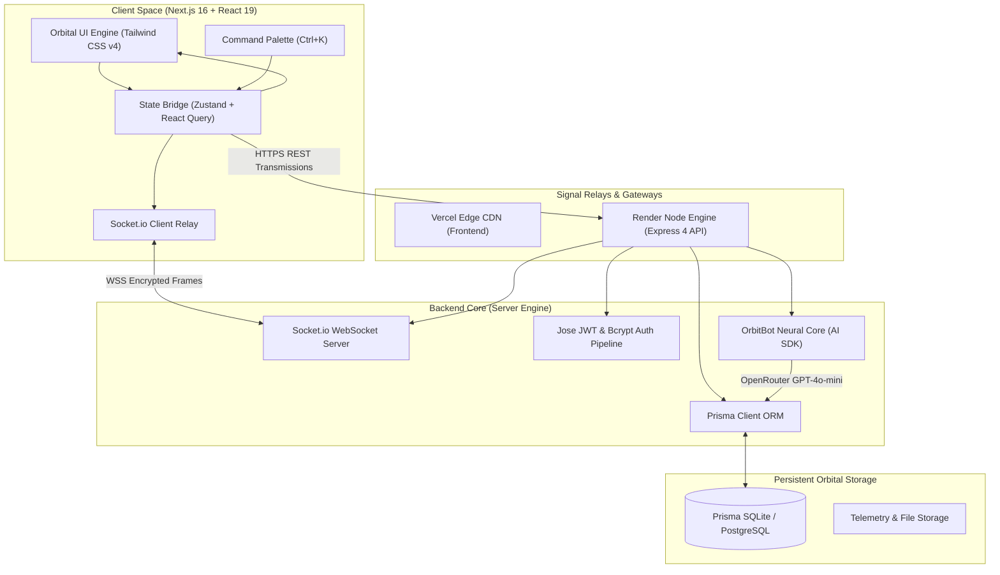

<div align="center">

# 🪐 OrbitChat
### *Next-Generation Deep Space Real-Time Communications & Autonomous AI Relays*

[](https://orbitchat-seven.vercel.app)
[](https://orbitchat-qfd3.onrender.com/api/health)
[](https://www.typescriptlang.org/)
[](LICENSE)

<br />

> **OrbitChat** is a cosmic-themed, high-performance real-time messaging hub engineered for orbital relays, interplanetary discussion channels, encrypted direct links, and autonomous station intelligence powered by **OrbitBot AI**.

[Explore Live Demo](https://orbitchat-seven.vercel.app) • [Architecture](#-station-architecture) • [Features](#-core-capabilities) • [Local Deployment](#-flight-manual-local-setup)

<br />

```
      .                                            .
               *             .        .        .        .
    .               .          .     .            .          .
     .    🪐 Orbit Station V2.6   .     .         .         .
        .           .        .         .        .            .
             .             .           .          .
```

</div>

---

## 🛰️ Mission Highlights

- ⚡ **Instantaneous Sub-Millisecond Relays**: Bidirectional WebSocket data-streaming driven by **Socket.io 4.8** with automatic reconnection fallback and optimistic UI updates.
- 🤖 **Autonomous OrbitBot AI**: Integrated neural copilot with multi-turn memory, channel synthesis (`/summarize`), code diagnostics, and conversational station guidance.
- 🪐 **Planet Channels & Direct Orbits**: Multi-crew open planetary frequencies (`general-orbit`, `engineering-core`, `deep-space-lounge`) and encrypted 1:1 direct transmissions.
- 🎙️ **Rich Audio & Media Telemetry**: Support for voice notes, audio playback, file sharing, code snippets with syntax highlighting, and Web Audio chimes.
- 🛡️ **Resilient Cross-Origin Auth**: Dual-layered session architecture utilizing HTTP-only cookie serialization paired with `Bearer` token local persistence for zero-friction mobile & desktop clearance.
- 🌌 **Cosmic Glassmorphic Interface**: Tailwind CSS v4 asymmetric glass panels, orbital pulse animations, dark/light theme switching, and WCAG AA contrast.
- 📱 **Mobile-First Command Palette**: Global `Ctrl+K` planetary search engine with dedicated touch back-navigation and adaptive bottom docking.

---

## 🏛️ Station Architecture



---

## ✨ Core Capabilities

### 1. 🤖 OrbitBot AI Copilot
OrbitBot is built directly into the station matrix. Crew members can invoke it at any moment:
- **1-Click Direct Chat**: Tap **🤖 OrbitBot** in the sidebar or mobile bottom nav to launch a private consultation.
- **Transmissions Synthesis (`/summarize`)**: In any public channel, invoke `/summarize` to condense recent crew discussions into actionable bullet points.
- **Direct Queries (`/ask <query>` or `@orbitbot`)**: Ask complex programming questions, quantum physics, or orbital flight maneuvers.

### 2. 🚀 1-Click Demo Crew Sign-In
Test the station instantly without registration using pre-cleared orbital identities:
- **Commander Nova** — *Station Lead* (`nova@orbit.chat` / `password123`)
- **Dr. Leo Vance** — *Telemetry Scientist* (`leo@orbit.chat` / `password123`)
- **Maya Chen** — *Quantum Architect* (`maya@orbit.chat` / `password123`)
- **Kai Thorne** — *Propulsion Engineer* (`kai@orbit.chat` / `password123`)

### 3. 🛸 Transient Guest Clearances
Need immediate access without saving credentials? Click **Guest Link** to generate a randomized temporary callsign (e.g., `guest_4821`), assign a planetary avatar, and auto-join all orbital channels.

### 4. 🔍 Unified Planetary Command Palette (`Ctrl+K`)
Instant search across:
- **Channels**: Discover and switch planet channels on the fly.
- **Crew Members**: Filter crew by callsign, online status, or mission role.
- **Transmissions**: Query historical log archives across all authorized frequencies.
- **Mobile Optimized**: Includes dedicated touch back-arrows and tap-to-dismiss backdrops for frictionless phone navigation.

---

## 🧰 Technology Matrix

| Layer | Technologies |
| :--- | :--- |
| **Frontend Framework** | [Next.js 16](https://nextjs.org/) (App Router, Turbopack), [React 19](https://react.dev/) |
| **Styling & Design** | [Tailwind CSS v4](https://tailwindcss.com/), Asymmetric Glassmorphism, [Lucide Icons](https://lucide.dev/) |
| **Client State** | [Zustand 5](https://github.com/pmndrs/zustand), [TanStack Query 5](https://tanstack.com/query) |
| **Real-Time Engine** | [Socket.io 4.8](https://socket.io/) (WebSockets + Polling Fallback) |
| **Backend Runtime** | [Node.js](https://nodejs.org/) & [Express 4](https://expressjs.com/) |
| **Database & ORM** | [Prisma ORM 6](https://www.prisma.io/) with SQLite (local/Render) or PostgreSQL |
| **Security & Tokens** | [Jose](https://github.com/panva/jose) (HS256 JWT), [Bcryptjs](https://github.com/dcodeIO/bcrypt.js), [Helmet](https://helmetjs.github.io/) |
| **AI Neural Core** | [Vercel AI SDK](https://sdk.vercel.ai/), OpenRouter (GPT-4o-mini), OpenAI Provider |
| **Deployment** | [Vercel](https://vercel.com/) (Frontend CDN) + [Render](https://render.com/) (Web Service Backend) |

---

## 🚀 Flight Manual: Local Setup

Follow these instructions to launch OrbitChat locally on your development vessel:

### Prerequisites
- **Node.js** >= 20.0.0
- **npm** or **pnpm**

### 1. Clone the Repository
```bash
git clone https://github.com/DipanshGore/orbitchat.git
cd orbitchat
```

### 2. Configure Environment Variables

**Backend (`server/.env`):**
```env
PORT=4000
DATABASE_URL="file:./dev.db"
JWT_SECRET="your_ultra_secure_orbital_secret_key_2026"
CLIENT_URL="http://localhost:3000"
NODE_ENV="development"

# OrbitBot AI Engine (Optional - will use rule-based fallback if omitted)
OPENROUTER_API_KEY="your_openrouter_api_key"
OPENROUTER_BACKUP_KEY=""
AI_MODEL="openai/gpt-4o-mini"
```

**Frontend (`client/.env.local`):**
```env
NEXT_PUBLIC_API_URL="http://localhost:4000"
```

### 3. Install Dependencies & Initialize Database
```bash
# Setup backend database
cd server
npm install
npx prisma db push
npm run build
cd ..

# Setup frontend client
cd client
npm install
cd ..
```

### 4. Launch Station Engines
Run both frontend and backend concurrently:
```bash
npm run dev
```

- **Frontend Station UI**: `http://localhost:3000`
- **Backend Relay API**: `http://localhost:4000`
- **Health Telemetry**: `http://localhost:4000/api/health`

---

## 🛰️ Planetary Frequencies (API Overview)

```
AUTH RELAYS
POST   /api/auth/register       -> Create new crew identity & auto-link OrbitBot
POST   /api/auth/login          -> Verify callsign & issue session credentials
POST   /api/auth/guest          -> Instant guest access pass
GET    /api/auth/me             -> Retrieve active identity payload
GET    /api/auth/seed           -> Manual trigger for startup database verification

CHANNELS & ORBITS
GET    /api/channels            -> List all accessible planetary channels
POST   /api/channels            -> Construct a new planet channel
GET    /api/conversations       -> List active 1:1 direct orbits & unread tallies
GET    /api/conversations/bot   -> Instant 1-click link to OrbitBot AI conversation
POST   /api/conversations       -> Initiate direct link with crew member

MESSAGES & SIGNALS
GET    /api/messages            -> Paginated transmission stream
POST   /api/messages            -> Transmit message (text/code/media/voice)
PATCH  /api/messages/:id        -> Correct/edit prior transmission
DELETE /api/messages/:id        -> Revoke/delete transmission

AI COPILOT
POST   /api/ai/ask              -> Query OrbitBot with prompt context
POST   /api/ai/summarize        -> Generate channel transcript summary
```

---

## ⌨️ Orbital Keybindings

| Shortcut | Action |
| :--- | :--- |
| <kbd>Ctrl</kbd> + <kbd>K</kbd> / <kbd>⌘</kbd> + <kbd>K</kbd> | Toggle Unified Command Palette & Planetary Search |
| <kbd>ESC</kbd> | Close Modals, Overlays, or Search Views |
| <kbd>Enter</kbd> | Transmit Message |
| <kbd>Shift</kbd> + <kbd>Enter</kbd> | Multi-line Transmission Break |

---

## 🛡️ License

This project is open-source and released under the **[MIT License](LICENSE)**.

---

<div align="center">

**Built with passion for next-generation real-time systems.**  
*Transmitting across orbital planes.* 🚀🪐

</div>
